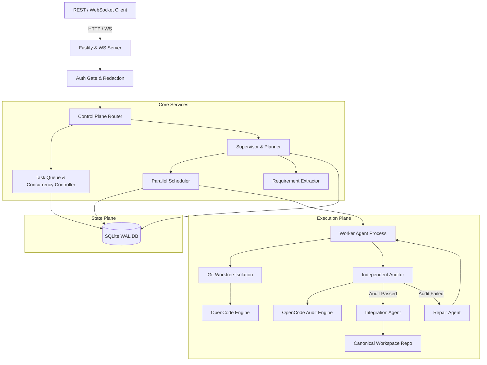
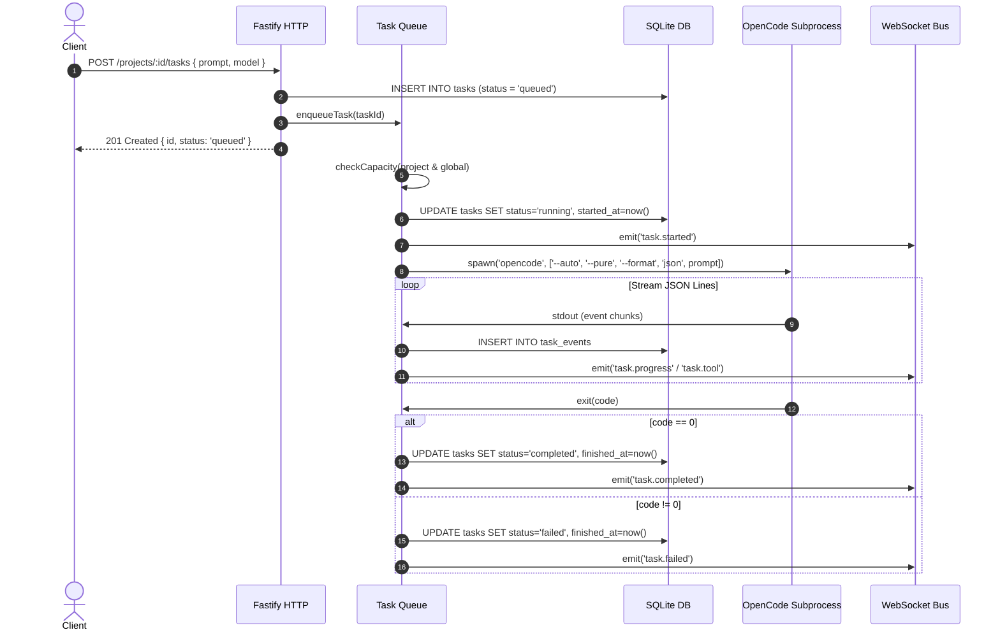
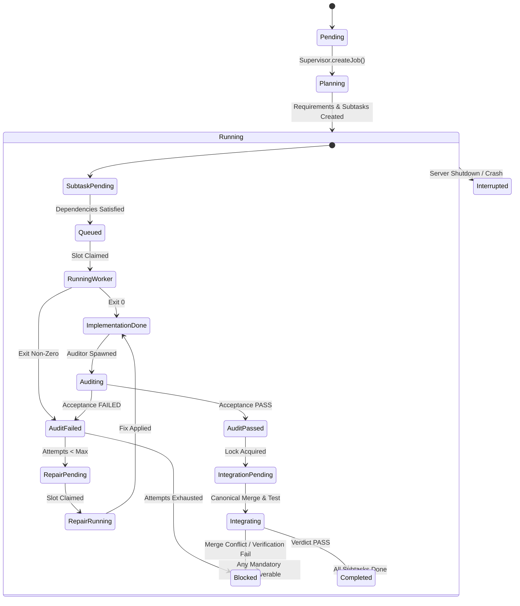

# Coding Orchestrator Architecture

## Overview

Coding Orchestrator is an autonomous agent control plane designed to execute complex, multi-stage software engineering tasks. It coordinates autonomous OpenCode coding engines across isolated Git worktrees, enforces independent verification audits, manages merge conflicts, and maintains persistent state in SQLite.

## System Boundaries

- **Client Plane**: External tools, developer CLIs, Discord/chat bridge interfaces communicating over authenticated HTTP REST and WebSocket connections.
- **Control Plane**: Fastify HTTP server with authentication pre-handlers, structured Pino logging with automatic credential redaction, request ID tracking, and disk pressure monitoring.
- **Orchestration Plane**: Task dispatch queue, Supervisor job decomposing engine, Parallel Scheduler managing concurrency slots, and Worktree Manager isolating file changes.
- **Execution Plane**: Sandboxed OpenCode child processes executed with non-interactive CLI flags (`--auto --pure --format json`).
- **Data Plane**: Single-file SQLite database configured with Write-Ahead Logging (`WAL`), foreign keys enabled, and automatic passive checkpointing.

## Execution Flows

### 1. Task Execution Lifecycle

### 2. Multi-Agent Job Lifecycle

### 3. Audit and Repair Loop

1. **Worker**: Generates code changes on a detached Git branch (`agent/<jobId>/<subtaskId>`) in an isolated worktree (`.agent-worktrees/<slug>/<jobId>/worker-<subtaskId>`).
2. **Auditor**: Launches independently on the worktree against explicitly defined acceptance criteria. Collects test output, syntax verification, and execution evidence.
3. **Verdict**: If `PASS`, proceeds to Integration. If `FAILED`, transfers control to the `RepairAgent`.
4. **Repair**: Receives the auditor's structured findings and the worktree context. Implements targeted corrections up to `MAX_REPAIR_ATTEMPTS` before marking the subtask `blocked`.

### 4. Integration Gate

To prevent corrupted Git histories and merge collisions, integration is guarded by project-level integration locks (`integration_locks` table):
- Only one agent can integrate into a canonical project workspace at any time.
- The Integration agent validates clean merges, executes project-level test commands, and records evidence in `agent_integration_results`.
- If a merge conflict occurs, the integration lock is released, and the subtask transitions to `blocked` for operator intervention.

### 5. Crash Recovery and State Reconciliation

- On startup (`src/server.js`), `recoverRunning()` queries all tasks marked as `running`.
- Any tasks orphaned by an unexpected server exit or machine reboot are transitioned to `interrupted`.
- Interrupted events are persisted to `task_events` and broadcast to WebSocket clients upon reconnection.
