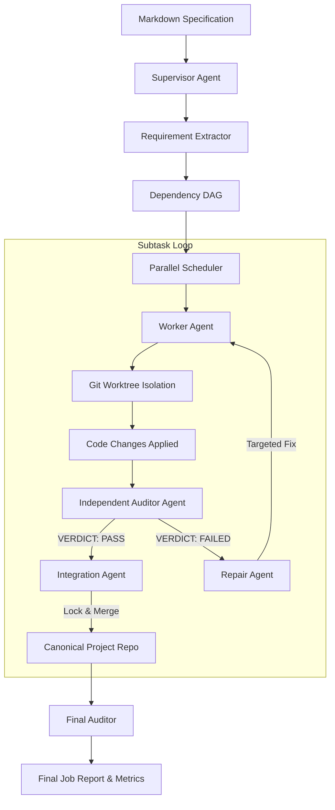

# Multi-Agent Orchestration Architecture

Coding Orchestrator provides a multi-agent system designed for autonomous execution of complex, multi-stage software engineering initiatives.



---

## 1. Supervisor

The `Supervisor` (`src/services/supervisor.js`) coordinates the lifecycle of high-level jobs submitted via `POST /jobs`.

### Responsibilities:
- **Requirement Extraction**: Parses Markdown project specifications into individual, numbered requirement records (`RequirementExtractor.extract`).
- **Dependency Graph Construction**: Analyzes explicit and inferred prerequisites between requirements, populating `dependency_edges`.
- **Cycle Detection**: Validates that the dependency graph is a Directed Acyclic Graph (DAG) using `ParallelScheduler.detectCycle`. If a cyclic dependency is detected, the job immediately enters `blocked` status.
- **Dispatching**: Evaluates the dependency graph and dispatches eligible subtasks whose dependencies have achieved `integration_passed` status.

---

## 2. Worker

The `Worker` agent implements the requested code changes for an assigned subtask.

### Execution Isolation:
- **Worktree Creation**: If the target project is a Git repository, the Worker operates in a newly created, isolated Git worktree on branch `agent/<jobId>/<subtaskId>`.
- **Non-Interactive Execution**: Launches OpenCode with `--auto --pure --format json`.
- **Session Capture**: Extracts the upstream OpenCode session identifier and records it in `job_subtasks` and `agent_executions`.
- **Exit Handling**: If the process exits with code 0, status transitions to `implementation_done`, immediately triggering the Auditor. If non-zero, status transitions to `audit_failed`.

---

## 3. Auditor

The `Auditor` agent performs independent verification of the Worker's implementation without human bias.

### Principles:
- **Strict Evidence Requirement**: The auditor is prompted: `"Do NOT fabricate evidence. Execute relevant verification commands."`
- **Isolated Evaluation**: Inspects code changes in the worktree against the requirement's `acceptance_criteria_json`.
- **Structured Output**: Must emit a valid JSON report containing:
  ```json
  {
    "verdict": "PASS",
    "subtaskId": "REQ-001",
    "sourceRevision": "c4b12a8...",
    "criteria": ["auth middleware exists", "tests pass"],
    "tests": ["npm test tests/auth.test.js"],
    "evidence": {"exitCode": 0, "passed": 5},
    "findings": [],
    "summary": "All acceptance criteria verified against test suite."
  }
  ```
- **State Transition**:
  - `PASS`: Subtask transitions to `integration_pending`.
  - `FAILED`: Subtask transitions to `repair_pending`.

---

## 4. Repair Agent

When an auditor rejects an implementation, the `RepairAgent` (`src/services/repair-integration-audit.js`) attempts targeted remediation.

- **Contextual Input**: Receives the original acceptance criteria and the auditor's specific findings and failure evidence.
- **Bounded Retries**: Enforces `MAX_REPAIR_ATTEMPTS` (default: 2). If attempts are exhausted without passing audit, the subtask transitions to `blocked`.
- **Re-Audit**: When a repair completes with exit code 0, the Auditor is automatically scheduled to re-verify the corrected worktree.

---

## 5. Integration Agent

The `IntegrationAgent` merges verified worktree branches into the project's canonical main repository.

### Safeguards:
- **Mutual Exclusion**: Acquires an exclusive lock in the `integration_locks` table. Only one subtask per project can integrate at any given time.
- **Conflict Handling**: Runs git merge operations. If a conflict or test regression occurs, the lock is released, and the subtask enters `blocked` status.
- **Verification**: Executes canonical workspace verification tests before committing the merge.
- **Result Recording**: Writes merge verdict, integrated commit hash, and conflict status into `agent_integration_results`.

---

## 6. Final Auditor

The `FinalAuditor` checks overall job completion once subtasks finish integration.

- Evaluates the ratio of verified mandatory requirements against total requirements.
- Computes `completion_percent` and sets `final_audit_verdict` to `PASS` when all mandatory requirements are satisfied.
- Generates a final JSON summary report stored in `jobs.report_json`.
