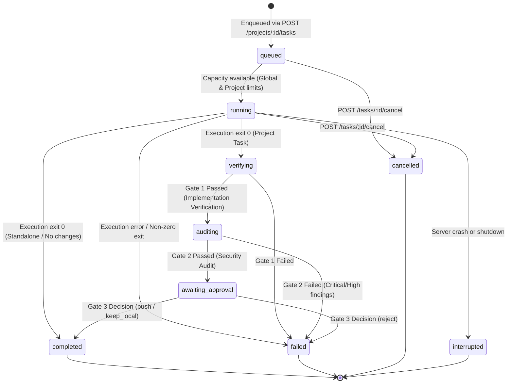

# Task Lifecycle

This document describes the state machine, scheduling rules, and cancellation flows for individual OpenCode tasks.

## State Machine

## State Definitions

Tasks maintain dual status tracking: `execution_status` (raw OpenCode subprocess execution) and `workflow_status` (overall multi-gate completion status).

| Workflow State | Execution State | Description |
|---|---|---|
| `queued` | `queued` | Task is stored in SQLite and added to the in-memory dispatch queue awaiting worker capacity. |
| `running` | `running` | OpenCode subprocess has been spawned (`opencode --auto --pure --format json <prompt>`). PID recorded. |
| `verifying` | `completed` | Subprocess finished. Gate 1 (ImplementationVerifier) is running syntax checks, lints, and test suites. |
| `auditing` | `completed` | Gate 1 passed. Gate 2 (SecurityAuditor) is performing deterministic secrets scanning and leak checks. |
| `awaiting_approval` | `completed` | Gates 1 & 2 passed. Gate 3 (ApprovalService) created a pending Git approval awaiting human decision. |
| `completed` | `completed` | All gates passed and human decided `push` or `keep_local` (or task completed with zero changes). |
| `failed` | `failed` | The subprocess failed, an automated gate failed, or human rejected the approval. Captured in `tasks.error`. |
| `cancelled` | `cancelled` | Execution was explicitly stopped via `POST /tasks/:id/cancel` before natural completion. |
| `interrupted` | `interrupted` | The orchestrator server shut down or crashed while active. Reconciled on restart. |

## Concurrency and Scheduling

The task scheduler (`src/services/task-queue.js`) enforces two layers of concurrency limits:

1. **Per-Project Concurrency**: Configured by `MAX_CONCURRENT_TASKS_PER_PROJECT` (default: 1). Only one task per project runs at a time to prevent file-locking collisions in non-worktree workspaces.
2. **Global Concurrency**: Configured by `MAX_CONCURRENT_TASKS` (default: 2). Limits the total concurrent child processes running on the host system.

When a running task completes or fails, `schedule()` is invoked automatically to dispatch the next eligible task from the queue.

## Disk Space Protection

Before enqueuing any task (`POST /projects/:id/tasks`), the orchestrator evaluates local filesystem metrics via `df -m .`:
- If available space is less than `MIN_FREE_DISK_MB` (default: 2048 MB) or utilization exceeds `MAX_DISK_USAGE_PERCENT` (default: 90%), the endpoint rejects the submission with HTTP status `507 Insufficient Storage`.

## Cancellation Process

When `POST /tasks/:taskId/cancel` is called:
1. If the task is in `queued` state, it is immediately removed from the dispatch queue and marked `cancelled`.
2. If the task is `running`, the orchestrator sends `SIGTERM` to the child process PID.
3. If the process does not exit within `CANCEL_TIMEOUT_MS` (derived from `TASK_KILL_GRACE_SECONDS`, default 10 seconds), the orchestrator issues `SIGKILL` to force termination.
4. The task status updates to `cancelled` in SQLite, and a `task.cancelled` event is broadcast over WebSocket.
